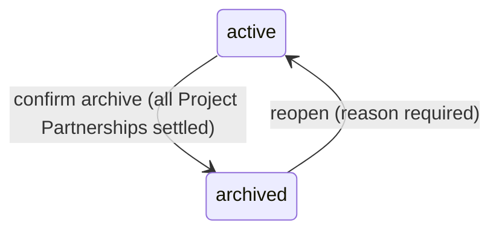

# Cost Tracker Project lifecycle

## Derived list status

`status` is a read-only projection over the Project archive flag and the Claim settled rule. It is not a state machine.

- `archived` when the Project is archived.
- `ready` when the Project is active and every Project Partnership has a settled Claim.
- `open` when the Project is active and at least one Project Partnership has no settled Claim.

A Claim is settled when it is `paid` or `rejected`. Status sort rank follows `open` → `ready` → `archived`.
